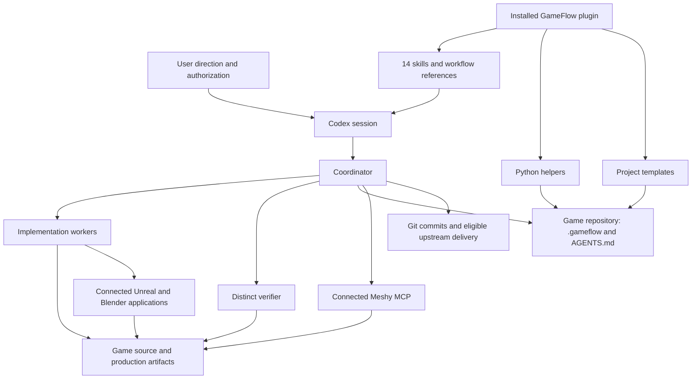
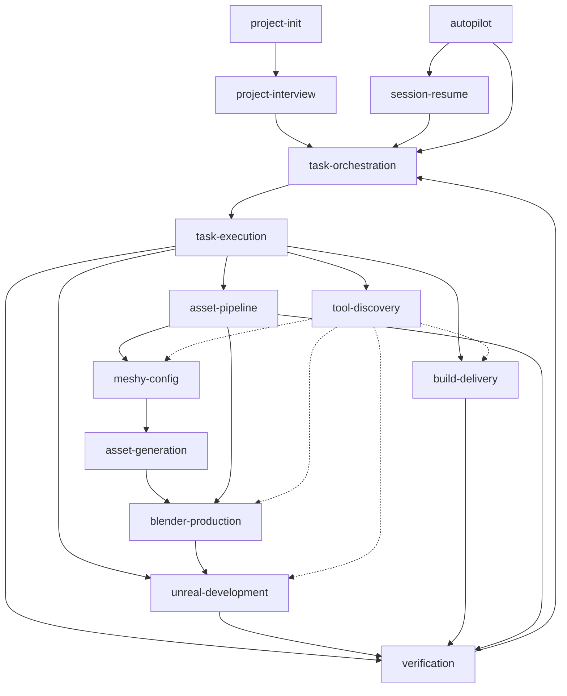
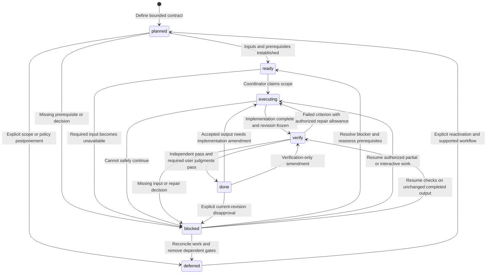
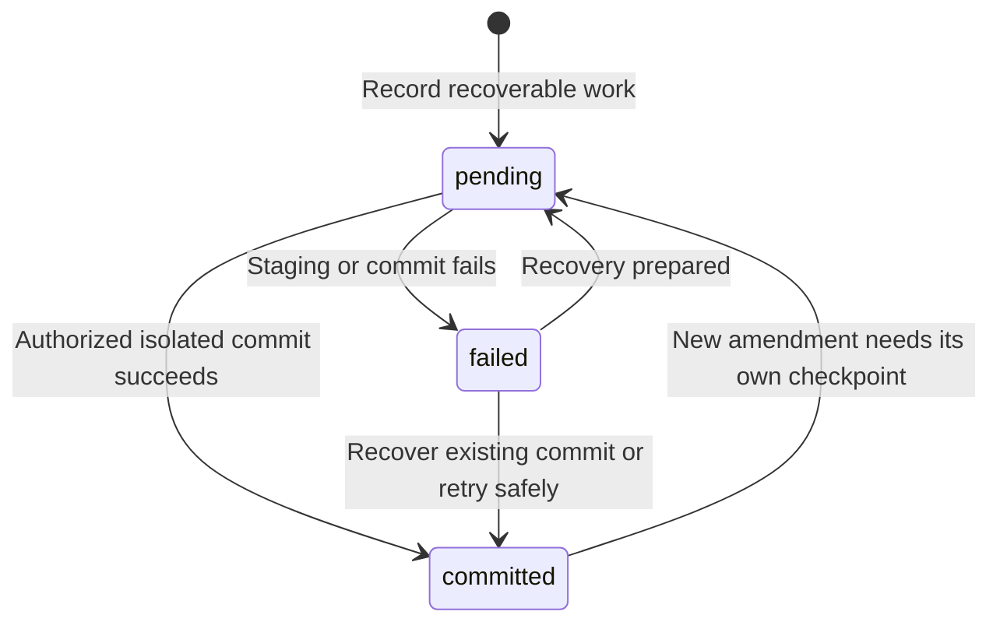
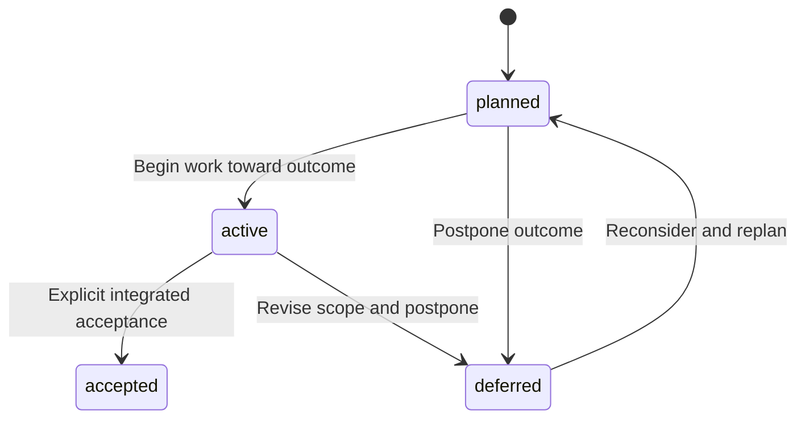
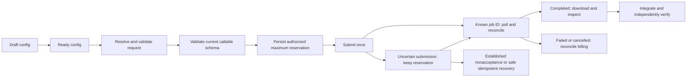
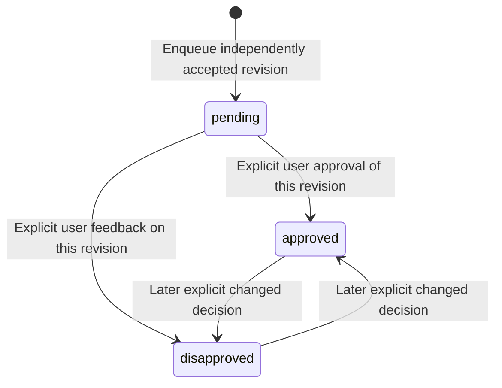
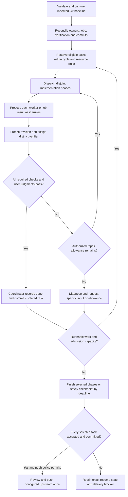

# GameFlow plugin architecture and workflow guide

GameFlow 0.9.0 is a Codex plugin for managing game development as bounded, resumable tasks. It combines 14 instruction-based skills, Python helpers, project templates, and durable project records. Its current production workflow supports Unreal development, Meshy-generated complex static meshes, Blender integration, and local builds and packaging. All rigging and animation production is deferred by default.

The central operating rule is that implementation, independent acceptance, Git commits, and delivery are separate events. A successful tool call does not complete a task. A task can be accepted but still need a commit. A completed run does not mean the game is complete.

This guide describes the repository's 0.9.0 implementation and policies. It includes the supported states and data elements, operational procedures, and an improvement backlog. Diagrams show intended workflow unless explicitly described as executable validation. Provider status names are provider-specific; conceptual provider phases below are not a new GameFlow enum.

## Reading map

- [Architecture and authority](#architecture-and-authority)
- [Skill map and definitions](#skill-map-and-definitions)
- [Project records and data ownership](#project-records-and-data-ownership)
- [Task contracts and task fields](#task-contracts-and-task-fields)
- [State machines](#state-machines)
- [Normal operating workflow](#normal-operating-workflow)
- [Autopilot and concurrency](#autopilot-and-concurrency)
- [Asset production and Meshy configuration](#asset-production-and-meshy-configuration)
- [Verification and review](#verification-and-review)
- [Recovery and delivery](#recovery-and-delivery)
- [Command and component reference](#command-and-component-reference)
- [Terminology](#terminology)
- [Gaps and improvement opportunities](#gaps-and-improvement-opportunities)
- [Validation and compatibility](#validation-and-compatibility)

## Architecture and authority

The plugin lives outside the game repository. The game repository contains its own `.gameflow/` state and a managed bootstrap block in `AGENTS.md`. Accepted source assets and runtime files live in the game's normal production directories; `.gameflow/` records their purpose, identity, provenance, and acceptance.



The arrows show responsibility or data flow, not a bundled runtime. GameFlow does not install an autonomous service, scheduler, provider client, or editor server. Codex interprets the skills inside the current session. Connected tools and native applications perform production actions. Python helpers inspect or update selected local records.

| Layer | What it supplies | What it does not establish |
| --- | --- | --- |
| Marketplace and plugin manifests | Local package identity, version, discovery metadata, and skill directory. | Application connections or a running game project. |
| Skills and references | Rules for selection, production, acceptance, recovery, and delivery. | Automatic enforcement of every rule. |
| Python helpers | Initialization, graph checks, context extraction, recipe resolution, review bookkeeping, migrations, and audits. | An execution engine for every lifecycle transition. |
| Project records | Durable decisions, task graph, contracts, provenance, and next actions. | Proof that a recorded worker is still alive or a tool is callable. |
| Connected applications | Actual editing, generation, inspection, and runtime operations. | Permission to spend, change direction, or overwrite another session. |
| Git | Versioned changes and delivery identities. | Independent acceptance or user approval. |

User instructions and authored project policies govern applicable authority. Templates supply defaults; refreshing the plugin does not overwrite an existing project's authored policy. A capability observation is not authorization. A ready Meshy config is not a budget. A prior approval applies to its recorded scope and artifact revision.

Sources: [plugin manifest](../.codex-plugin/plugin.json), [marketplace](../../../.agents/plugins/marketplace.json), [workflow](WORKFLOW.md), [tool discovery](../skills/tool-discovery/SKILL.md).

## Skill map and definitions

A **skill** is a named `SKILL.md` instruction entrypoint with supporting references. Skills compose: invoking one can route work through others. They are not mutually exclusive states, and invoking a production skill does not automatically allocate a task, run its checks, or commit its output.



Solid arrows show common routing; dotted arrows show capability support. Generation can deliver a usable format without Blender, and existing assets can enter integration without generation. The coordinator chooses the path required by the contract.

| Skill | When and why to use it | Inputs and responsibilities | Result and boundary |
| --- | --- | --- | --- |
| [project-init](../skills/project-init/SKILL.md) | Start GameFlow in a game repository or audit its structure. | Project path, name, engine; add missing templates and managed entrypoint; run validation. Audit requests validate without initialization. | Durable scaffold, initially including the first-slice task. Existing truth is preserved. Explicit guidance upgrades use a separate migration. |
| [project-interview](../skills/project-interview/SKILL.md) | Establish missing direction or revise major creative direction. | Existing project documents; one to three related questions at a time; distinguish confirmed facts, assumptions, experiments, and unknowns. | Accepted vision, constraints, gameplay/art/interface direction, first vertical slice, decisions, and bounded tasks. No invented direction or transcript storage. |
| [session-resume](../skills/session-resume/SKILL.md) | Continue from durable state in a new session or determine next work. | Managed bootstrap, validation, full recovery records, contracts, Git and job evidence. Reconcile before selecting new work. | A recovered phase or genuinely actionable next task and updated handoff. No automatic migration, duplicate jobs, or assumption that an old owner is live. |
| [task-orchestration](../skills/task-orchestration/SKILL.md) | Decompose outcomes, allocate IDs, assign work, and manage the canonical graph. | Scope, dependencies, inputs, observable acceptance, required context, ownership, resource limits. | Bounded contracts, claims, transitions, proposed child work, and acceptance bookkeeping. Coordinator alone writes shared state; deferred tasks remain leaves. |
| [task-execution](../skills/task-execution/SKILL.md) | Implement one bounded task or resume its partial work. | Ready task or recoverable checkpoint, contract, required context, authority, tool access, owned outputs. | Actual deliverable and evidence at `verify`, or an exact blocked/partial checkpoint. No self-certification or silent scope expansion. |
| [autopilot](../skills/autopilot/SKILL.md) | Advance several eligible tasks within explicit run limits. | Resume state, Git baseline, project autopilot policy, task-cycle/time/repair allowances. | Concurrent authorized work, independent checks, serialized commits, checkpointed unfinished work, and an eligible final push. Runs only in the current session. |
| [tool-discovery](../skills/tool-discovery/SKILL.md) | Establish actual application/provider capability before relevant work or after a connection changes. | Selected task, live exposed schemas, app/project identity, dirty state, ownership, executable host paths. | Observed capability/application records and a supported execution route, or a precise blocker. No billable probes, speculative availability, or automatic MCP reconfiguration. |
| [meshy-config](../skills/meshy-config/SKILL.md) | Define or inspect deterministic prompt recipes and operation settings. | Approved brief, current config, live schemas, allowance policy reference. | Nonsecret config plus offline validation and resolved request JSON. The helper neither saves config nor submits jobs or reserves spending. |
| [asset-generation](../skills/asset-generation/SKILL.md) | Generate a complex mesh through Meshy MCP. | Task/asset ID, resolved recipe, live schema, permitted uploads, bounded allowance and reservation. | Preserved provider outputs, job identity, settings, provenance, and delivery evidence at `verify`. No alternate provider, direct HTTP, local modeling fallback, or automatic creative regeneration. |
| [asset-pipeline](../skills/asset-pipeline/SKILL.md) | Track an asset across generation, downloads, conversion, import, and acceptance. | Stable asset ID, brief, authoritative source, destinations, dependencies, provenance and criteria. | Manifest lineage, recoverable stage boundaries, independent delivery checks, optional review queue. It coordinates stages rather than creating all assets itself. |
| [blender-production](../skills/blender-production/SKILL.md) | Integrate existing or delivered meshes and prepare safe review scenes. | Asset identity, source files, integration conventions, task-owned working copy, exclusive app access. | Derived transforms/material hookups/export, or explicitly permitted simple primitives. No complex modeling, sculpting, retopology, creative repainting, rigging, or animation by default. |
| [unreal-development](../skills/unreal-development/SKILL.md) | Implement gameplay, levels, static asset integration, materials, interface, and audio behavior. | Contract, repository constraints, correct project/map, discovered operations or established native tooling. | Owned source/package changes and checks of actual resulting properties or behavior at `verify`. Tool availability does not override a C++-only rule or establish runtime success. |
| [build-delivery](../skills/build-delivery/SKILL.md) | Compile, test, profile, cook, or package the game. | Established engine/toolchain, platform/configuration, build instructions, owned outputs and app access. | Reproducible commands, results, measurements or local package and smoke-test evidence. Packaging does not imply launch success; publishing/distribution needs explicit authorization. |
| [verification](../skills/verification/SKILL.md) | Independently assess the frozen deliverable against every required criterion. | Contract criteria, immutable artifact identities, relevant tools/environment, any required user judgment. | Pass/fail/not-tested findings and revision-bound evidence. The coordinator records `done` only after all required checks and user judgments pass. |

## Project records and data ownership

The following paths are inside the game project unless prefixed with `plugins/gameflow/`. A missing optional newer record does not invalidate a legacy schema-v1 project merely because a current template contains it.

| Element | Definition and authority |
| --- | --- |
| `AGENTS.md` managed block | Session bootstrap: read `PROJECT.md`, `CONSTRAINTS.md`, `sessions/CURRENT.md`, then the compact task view or index. Read full selected/recovery records and contracts. Markers delimit managed guidance; surrounding authored instructions remain. |
| `.gameflow/PROJECT.md` | Vision, pillars, target experience, milestones and game-completion criteria. Its completion criteria govern the whole game. |
| `CONSTRAINTS.md` | Hard production, engine/language, platform, budget, licensing and other boundaries. |
| `ART_DIRECTION.md` | Visual thesis, shape, color/value, materials, motifs and reference direction. A motion-language section does not activate deferred motion production. |
| `GAMEPLAY.md` | Player fantasy, core loop, player verbs, system relationships, progression and tuning. |
| `INTERFACE.md` | Interaction, information hierarchy, input, accessibility, visual/audio feedback. |
| `ARCHITECTURE.md` | Module/content ownership, naming, paths, coordinate conventions, build commands and automation boundaries. |
| `DECISIONS.md` | Material decisions and rationale. Supersede an old decision with a new entry rather than erasing its history. |
| `GLOSSARY.md` | Project-specific terms that could otherwise change implementation or evaluation. Distinct from the plugin's own glossary. |
| `AUTOPILOT.md` | Project run limits, authority, stop/no-contact policy, provider allowance and delivery rules. Optional in legacy projects; skill defaults apply when absent. |
| `tasks/index.json` | Sole canonical task graph, task lifecycle, dependencies, owners, optional planning metadata and checkpoints. |
| `tasks/TASK-NNNN.md` | Human-readable task contract: exact outcome, inputs, outputs, acceptance, context and evidence. |
| `planning.json` | Optional milestone and epic definitions. It references tasks through task `epic` assignments rather than duplicating the task database. |
| `PLANNING.md` | Project planning guidance. |
| `ROADMAP.md` and `epics/EPIC-NNNN/EPIC.md` | Generated navigation. Edit definitions/contracts and regenerate, rather than treating these views as authoritative. |
| `assets/manifest.json` | Canonical asset registry: stable IDs, source authority, engine destination, provenance, dependencies and delivery identity. The template starts with an empty `assets` list; detailed entry fields are largely policy-defined. |
| `assets/specifications/` | Substantial asset briefs. |
| `assets/references/` | Durable approved references, registered in the manifest. |
| `assets/manual-review.json` | Optional revision-specific feedback queue and actual/deferred presentation record. Missing legacy queue is valid and can be initialized on first delivery. |
| `tools/meshy.json` | Nonsecret Meshy configuration, version 1: defaults, schema snapshots and recipes. Missing config leaves legacy structure valid but blocks complex generation. |
| `tools/capabilities.json` | Observed available operations, limitations and tool identity. Not executable connection configuration or permission. |
| `tools/applications.json` | Observed application versions, identity and host/path information. Recheck identity and ownership before mutation. |
| `verification/standards.md` | Tracked common acceptance standards. Task criteria determine which checks apply. |
| `verification/results/` | Detailed check reports, local-only by default. Compact acceptance conclusions must also be in tracked contracts. |
| `verification/temporary/` | Disposable screenshots, captures and intermediate renders. Remove only the current attempt's captures after recording conclusions. |
| `sessions/CURRENT.md` | Current milestone, completed changes, active selections, blockers/questions, verification/commit/job state and exact next actions. A current handoff, not a conversation transcript or duplicate procedure manual. |
| `ARTIFACT_RETENTION.md` | Project policy for tracked production inputs/conclusions versus local-only experiment and verification payloads. |
| `migrations/` | Guidance migration backups and receipts used for guarded recovery. Planning migration also keeps its own backed-up originals. |
| `Artifacts/` and `Experiments/` | Default ignored game-root locations for detailed outputs and experimental payloads. Accepted production assets should be promoted to production paths. |

**Ownership:** one coordinator writes shared index, manifest, policy and handoff records, allocates task IDs, reserves/submits paid work, and stages/commits. Workers edit assigned disjoint outputs and return proposed shared-state changes. Application workers also need exclusive access to the relevant shared editor. A worktree does not isolate Blender selection or Unreal play state.

Sources: [templates](../templates/gameflow), [bootstrap](../templates/AGENTS.block.md), [planning](PLANNING.md), [retention](ARTIFACT_RETENTION.md).

## Task contracts and task fields

One task should deliver one principal durable result with existing inputs, observable acceptance, a recoverable stopping point, and a useful failure report. A `parent` expresses decomposition; `depends_on` expresses a prerequisite. A parent-child relationship alone does not order execution or imply acceptance propagation.

### Contract sections

| Section | Definition |
| --- | --- |
| Outcome | The result to achieve, not a list of tool calls. |
| Inputs | Existing source files, approved decisions, prior deliveries and other prerequisites. |
| Outputs | Named durable artifacts and the intended scope of changes. |
| Acceptance | Observable conditions, verification method and expected evidence for each condition. Include required user judgment explicitly. |
| Context Required | Project-root-relative Markdown links to required files, optionally with heading fragments. Percent-encode spaces; do not use URLs, absolute paths, traversal or escaping symlinks. |
| Context Excluded | Descriptive guidance about material not needed, such as temporary captures and unrelated history. |
| Completion evidence | Actual checks, results, artifact revision/hash, command/job identities, residual risks and relevant evidence references. |

The context helper extracts references without recursively loading their contents. Legacy prose and unparsed text require direct reading. A compact packet never replaces the contract or proves readiness.

### Index fields

| Field | Meaning |
| --- | --- |
| Root `schema_version` | Persisted format label; current templates use `1`. This is distinct from plugin release `0.9.0`. |
| Root `next_id` | Integer above every allocated task number; used by the coordinator's task allocator. |
| Root `tasks` | Canonical array of task objects. |
| `id` | Stable `TASK-` ID with at least four digits, such as `TASK-0001`. |
| `title` | Human-readable deliverable label. |
| `status` | Exactly one of the seven task states below. |
| `parent` | Another task ID or null; decomposition relationship. |
| `depends_on` | Array of prerequisite task IDs. Both dependency and parent graphs must be acyclic. |
| `owner` | Assigned worker/session identity or null. A label is not a live process lock. |
| `contract` | Existing path relative to `.gameflow/`, confined within it. This differs from project-root-relative links inside the contract. |
| `checkpoint` | Optional versioned recovery record. Existing tasks without it remain compatible and are reconciled when needed. |
| `execution_mode` | `autonomous` by default; `interactive` requires user-directed implementation/revision. |
| `epic` | Optional epic ID; an assignment requires valid `planning.json`. |
| `kind` | `delivery` by default or `experiment`. |
| `experiment_outcome` | Required for experiments: `pending`, `adopted`, `rejected`, `superseded`, or `inconclusive`. Not valid on delivery tasks. |
| `priority` | Optional scheduling metadata exposed by the compact view. The workflow chooses higher-priority eligible work; there is no central numeric priority schema or scheduler CLI defining all ordering. |
| `disposition` | Optional classification. Planning summaries exclude `superseded` and `retired_asset`; this does not itself accept a task or change its lifecycle. When planning validation applies, a `superseded` task must be `deferred`. |

Sources: [task template](../templates/task-contract.md), [task allocator](../scripts/new_task.py), [validator](../scripts/validate_gameflow.py), [context helper](../scripts/task_context.py).

## State machines

### Task lifecycle



These arrows describe normal policy transitions, not an exhaustive transition validator. Safe deferral can originate from other phases after ownership and dependent contracts are reconciled. The initial template deliberately creates the first-slice definition task at `ready`; the diagram's `planned` entry describes ordinary newly allocated tasks.

| State | Exact operational meaning | Exit condition |
| --- | --- | --- |
| `planned` | Defined but not yet established as executable. | Inputs and prerequisites become available, or a specific blocker/deferral is recorded. |
| `ready` | Inputs exist and prerequisite tasks are accepted; required commit recovery is reconciled before dispatch. | Coordinator claims the task and disjoint outputs/resources. |
| `executing` | Implementation is claimed/in progress, possibly with a pending external job. | Completed output moves to verification; inability to proceed yields a checkpoint/blocker. |
| `verify` | Implementation is complete, but independent acceptance and/or required user judgment remain pending. | All required criteria pass, or findings trigger bounded repair/blocking. |
| `done` | A distinct verifier's acceptance is recorded for the identified revision, and all required user judgments passed. | Normally remains accepted; changed outputs or explicit feedback can reopen it. Commit state is separate. |
| `blocked` | A specific missing input, decision, capability, allowance or operational obstacle prevents the affected work. | Useful authorized recovery or explicit input resolves the obstacle; resume the correct phase. |
| `deferred` | Deliberately postponed by scope/policy, with a reason and explicit reactivation condition. Unfinished and skipped by automatic selection. | Explicit direction satisfies reactivation conditions; return to `planned`. |

Deferred tasks may depend on delivered static work, but **no task may depend on a deferred task**. Before deferral, rescope affected active contracts and remove their gates explicitly. A new connected provider does not reactivate deferred rigging/animation. If a deferred feature remains required by game-completion criteria, the game remains incomplete.

### Checkpoint and commit lifecycle

`checkpoint.phase` mirrors task `status`; it does not add another task state. Git commit state is independent:



`pending` means the required commit remains unresolved; `failed` records an unsuccessful commit operation; `committed` requires a Git hash. A partial commit can preserve incomplete work without making it `done`. An accepted task with a pending/failed commit needs commit recovery, not reimplementation. Dependents wait for reconciliation.

| Checkpoint field | Definition |
| --- | --- |
| `version` | Checkpoint format version `1`. |
| `phase` | Same value as the enclosing task status. |
| `authority` | Durable reference/text establishing authorized scope. Structural validation only checks that it is populated. |
| `base_head` | Git commit before task/run work; preflight checks ancestry. |
| `owner` | Current worker/session identity or null, reconciled before clearing. |
| `artifact_paths` | Complete output files covered by acceptance; each must appear in `owned_paths`. A done checkpoint needs nonempty scope. |
| `owned_paths` | Project-relative file paths mapped to SHA256 identities; null denotes intentional deletion. Includes owned outputs/evidence. |
| `shared_state_review` | Reference/text describing reviewed shared-file deltas, participating tasks and serialization. Avoids falsely claiming ownership of the whole index/handoff. |
| `preserved_baseline` | Hash map of unrelated inherited dirty files to preserve. Mixed edits require separate delta review. |
| `jobs` | Provider job objects with real IDs and recovery information. Current generic validation checks object structure, not a complete provider job schema. |
| `repair_counts` | Criterion-to-consumed-attempt integer map. Counts survive worker changes and resumes. |
| `next_action` | Exact action needed to resume. |
| `acceptance` | Null until accepted, or `revision` hash map, distinct `verifier` identity and `evidence` reference. Covers every output artifact. |
| `commit` | `state` of `pending`, `failed`, or `committed`, plus `hash` when committed. |

Do not hash the checkpoint into itself. Shared state is handled through reviewed deltas. Changed accepted artifacts invalidate affected acceptance and require dependent-impact review.

Source: [checkpoint protocol](../skills/task-orchestration/references/checkpoints.md), [preflight implementation](../scripts/checkpoint_preflight.py).

### Planning and experiment states

Milestones define integrated deliverables. Epics define substantial outcomes within a milestone. Both use `planned`, `active`, `accepted`, and `deferred`. They do not use the task enum.



This is a conceptual planning flow: `planning.py` validates status values but does not implement this transition machine. `planned` means defined future work; `active` means currently pursued; `accepted` means explicit integrated acceptance; `deferred` means postponed. Completed children alone do not establish epic/milestone acceptance.

| Planning element | Fields |
| --- | --- |
| Root | `schema_version: 1`, `milestones`, `epics`. |
| Milestone | `id` (`MILESTONE-NNNN`), `title`, `status`, `acceptance`, optional milestone `depends_on`. |
| Epic | `id` (`EPIC-NNNN`), `title`, `status`, `milestone`, `outcome`, `acceptance`, `boundaries`. |

Experiments also have a separate outcome: `pending` means undecided, `adopted` means the tested approach is selected, `rejected` means it is not selected, `superseded` means replaced by a later investigation/decision, and `inconclusive` means the investigation did not settle the question. A verified negative result can be `done` with outcome `rejected`. An obsolete unfinished experiment should be deferred with a superseded disposition, not falsely accepted. Adoption may require a separate production delivery task.

Source: [planning rules](PLANNING.md).

### Meshy configuration and provider phases

Config status is either `draft` or `ready`. A draft can preserve incomplete choices but must still be structurally valid. Ready config has at least one valid recipe and required operation snapshots; only ready config resolves. Readiness does not establish live availability or spending permission.



Provider phases are conceptual; use the actual tool's statuses. A timeout can occur after charging. Failure or cancellation is not proof of zero charge. `resume_view.py` recognizes `completed`, `succeeded`, `failed`, `cancelled`, and `canceled` as terminal job strings for compact recovery visibility; other or absent strings remain visible for reconciliation. This normalization does not settle billing or establish acceptance.

### Optional review and presentation states



A replacement is a **new entry** at `pending`, not a reset of the previous revision. Older entries remain as history with `current: false`. Explicit current-revision disapproval requires coordinator action to reopen the original task in interactive mode; the queue helper does not do that automatically.

Presentation independently has `pending` (refresh needed), `shown` (the exact selected revisions were actually displayed), or `deferred` (presentation cannot safely happen yet). A deferred presentation is not a deferred task or a failed technical check.

| Queue element | Definition |
| --- | --- |
| `schema_version`, `enabled`, `window_size` | Version `1`, boolean review enablement, fixed window of `5`. |
| `entries` | Append-ordered delivery history; append order, not timestamps, determines recency. |
| Entry identity | `asset_id`, source `task_id`, immutable delivery `revision`, reopenable `artifact`, and `completed_at`. Revision should hash the delivery manifest including geometry, textures/materials and import settings. |
| Entry state | `current` identifies the latest revision per asset; `status` is `pending`, `approved`, or `disapproved`. |
| Decision evidence | `user_feedback`, `reviewed_at`, and appended `decisions` containing status, feedback and decision time `at`. |
| `presentation` | `status`, exact asset/revision `selection`, `reason`, and timestamp `at` when recorded. |

Only current pending entries occupy the newest-five window. Approved and disapproved entries remain recorded but leave that window. The prose term “unreviewed” therefore means pending entries, not every entry lacking approval. Review history and optional extra fields survive helper updates.

Source: [optional review protocol](../skills/asset-pipeline/references/optional-review.md), [queue helper](../scripts/asset_review.py).

## Normal operating workflow

### Start a project

1. Install GameFlow outside the game repository using the [repository installation instructions](../../../README.md#install-in-codex-cli). Application connections are reused; the package does not configure them for you.
2. Ask `gameflow:project-init` to initialize the chosen game repository. It adds missing state and validates it. The initial ready task is to define the first vertical slice.
3. Use `gameflow:project-interview` to establish intent/player experience, gameplay, art/audio, interface/accessibility, production boundaries, and the first slice. Accepted phase conclusions update existing documents.
4. Use orchestration to turn the slice into bounded tasks. Record scope, required inputs, dependencies, acceptance and context before readiness. Define optional milestones and epics if useful.
5. Discover only the tools required by the selected task. Verify connected application/project identity and both execution-host path forms when Windows and WSL are involved.
6. If complex generation is needed, configure Meshy recipes and separately establish spending/upload authority. An empty draft and no paid allowance are the default.
7. Execute a ready task, or invoke bounded autopilot. Independently verify its result and checkpoint the actual phase before stopping.

Example requests, with project-specific details substituted:

```text
Use gameflow:project-init in this repository for an Unreal game.
Use gameflow:project-interview to define the first playable slice.
Use gameflow:meshy-config to prepare recipes from the approved static prop brief.
Use gameflow:task-execution for TASK-0002.
Use gameflow:autopilot within the existing project policy.
Use gameflow:session-resume to recover pending work and select the next task.
```

These are requests to skills, not shell commands. Specify exceptions, a no-push preference, required reviews or additional limits when those should apply.

### Follow a concrete asset through delivery

Suppose the accepted slice needs one static forest rock. The task contract names its brief, output locations, material dependencies and intended Unreal destination. The manifest allocates a stable asset ID. A configured Meshy recipe resolves the approved subject and explicit settings; the coordinator checks live schema and authorized maximum charge before reserving and submitting once.

The returned job ID is persisted immediately. If the session ends while it runs, the next session polls that ID. After completion, original downloads remain preserved. Blender is used only if required for permitted orientation, unit/pivot correction, material hookup or export. Unreal imports and loads the identified output if the contract requires it.

A distinct verifier checks job completion, readable expected files, dependencies, intended loading and recorded provenance. After any required user judgments also pass, the coordinator records acceptance and `done`, commits isolated changes, and enqueues the accepted revision for optional review. A separate combined rigging/animation task, if recorded for the asset, remains a deferred leaf and contributes nothing to completion.

For a gameplay task, replace the generation stages with source/editor implementation and behavior tests. Cheap mesh delivery checks do not replace gameplay interaction, audio playback, compile, cook or package tests.

## Autopilot and concurrency

Autopilot authorizes ordinary local implementation, testing, application automation, child tasks, state updates and verified task commits. Its default also allows one eligible end-of-run push to the current branch's configured GitHub upstream, unless prohibited by user/project policy. It does not authorize purchases, arbitrary spending, publishing, pull requests, credential changes, external communications, or unresolved creative decisions.

Without an authored `AUTOPILOT.md`, the limits are at most three completed task cycles, 90 minutes elapsed time, and one repair attempt per failed criterion. The fresh template also specifies stopping at least 15 minutes before the next scheduled run. A scheduled invocation must not overlap its next scheduled run. The plugin does not install that schedule.



This diagram compresses a concurrent loop. Other independent work can continue during verification, commit, provider waiting or a task-specific blocker. Recovery is priority order, not a global batch barrier.

The admission invariant is:

```text
completed task cycles + selected unfinished task reservations <= run cycle limit
```

Recovery of unfinished work, including an accepted task awaiting commit, consumes a reservation. Repair, verification and polling use that same reservation. Child tasks need their own. Reaching the reservation cap stops new admission, not already-reserved phases. Inherited work above the cap must still be reconciled and checkpointed; do not remove selections to manufacture success.

| Resource or action | Scheduling rule |
| --- | --- |
| Independent source outputs | Can run concurrently within actual runtime and project limits. |
| Task dependency | Consumer waits for prerequisite acceptance and commit reconciliation. |
| Coordinator/shared state | Single writer. Workers return proposed updates. |
| Worker slots | Count coordinator and all live agents; idle agents may still occupy slots. Reserve capacity for independent verification. |
| Shared Unreal/Blender instance | Serialize mutations, including selection changes, file opening, PIE and saves during nominally read-only inspection. |
| Build/cook output | Serialize overlapping outputs and editor/process contention. |
| Paid provider operations | Coordinator serializes reservations/submissions; known jobs may overlap within allowance. Waiting jobs need no idle agent. Uncertain charges require reconciliation. |
| Git staging/commits | Coordinator-only and serialized; freeze accepted outputs through commit recovery. |

A verifier must not have implemented or repaired the artifact it accepts. Without an available distinct verifier, implementation stays at `verify`; a second self-review does not satisfy the requirement.

An empty ready queue triggers diagnosis: trace dependencies to the first actionable prerequisite, attempt authorized recovery, and ask a precise question if input is missing. User-invoked runs can become interactive while independent work proceeds. Hard deadlines, explicit stops, no-contact policies, unresolved global ownership, and exhausted authority still limit action. Additional repairs require explicit allowance, not a fresh worker or renamed child task.

Sources: [autopilot](../skills/autopilot/SKILL.md), [concurrent scheduling](../skills/task-orchestration/references/concurrent-scheduling.md), [blocker resolution](../skills/task-orchestration/references/blocker-resolution.md).

## Asset production and Meshy configuration

### Production boundaries

Complex mesh creation goes exclusively through connected Meshy MCP. A complex object assembled from scripted primitives is still a complex mesh. Explicit simple-shape tasks may create a primitive cube or plane locally; this is not permission to replace a requested final complex asset with a placeholder.

Existing assets can be integrated without regeneration. Blender may convert formats, apply declared units/axes/orientation/pivots, select export objects, resolve texture paths and connect supplied maps to the engine's material contract. Preserve originals and derived lineage. Creative anatomy/silhouette changes, retopology, repainting and material redesign are outside the default integration scope. Apply explicit existing user-authorized exceptions when relevant rather than repeatedly asking for the same authority.

Rigging and animation production/integration are deferred across all providers and local tools. Newly discovered providers stay inactive. Meshy is not an audio generator; existing audio has a separate engine integration route.

### Configuration dictionary

| Element | Fields and behavior |
| --- | --- |
| Config root | Exactly `version`, `status`, `operation_defaults`, `schema_snapshots`, `recipes`. |
| Operation ID | Local identifier connecting defaults, a snapshot and a recipe. It is not an assumed provider endpoint name. |
| Operation defaults | Operation-ID map to `{ "settings": { ... } }`. Explicit settings only. |
| Schema snapshot | `tool` is the exact discovered MCP tool name; `captured_at` records time; `input_schema` is the complete argument schema; `prompt_field` is the actual top-level prompt property or null. |
| Recipe | Required `id`, `operation`, human-readable `criteria`, integer `priority`, `prompt_template`, `variables`, and `settings`; optional `category`, `tags`, `optional_clauses`. |
| Criteria | Prose evaluated by the agent. The resolver does not perform semantic matching. Pass evaluated matches explicitly or name a recipe. |
| Priority | Higher integer wins among supplied matches; highest-priority ties fail. Explicit named selection bypasses ranking. This priority is separate from task scheduling priority. |
| Prompt template | Python string-template placeholders `$subject` or `${subject}`; `$$` yields a literal dollar. |
| Variables | Declared string inputs, all required even if unused. Settings do not interpolate variables. Structured values belong in task overrides. |
| Optional clause | Fixed literal `text` with explicit boolean `default`. A boolean input enables the text or inserts an empty string; no arbitrary replacement text or recursive interpolation. |
| Task overrides | Explicit top-level settings that override the recipe and defaults. Nested objects replace previous nested objects entirely. |

Settings resolve in order: **operation defaults → selected recipe → explicit task overrides**. The rendered prompt is then inserted into the snapshot's prompt field; that field cannot also appear in settings. JSON Schema defaults are not auto-filled. Argument keys must exist in the snapshot's top-level properties and satisfy its schema.

Snapshots must be self-contained: external/reference keywords `$ref`, `$dynamicRef` and `$recursiveRef` are rejected. Duplicate JSON keys, nonfinite numbers, unknown dialects and credential-bearing fields are rejected. Ordinary prose could still contain a secret, so key-based checks are not complete secret detection. Configured snapshots require `jsonschema>=4,<5`; validating an empty draft needs only the standard library.

Optional clause example, a fragment within a complete recipe:

```json
{
  "prompt_template": "A ${subject} ${detail_clause}on a neutral background.",
  "variables": ["subject"],
  "optional_clauses": {
    "detail_clause": {"text": "with restrained surface detail ", "default": false}
  }
}
```

The trailing space is intentional. `true` inserts that exact text; `false` omits it. String `"false"` is invalid. Existing string-variable recipes remain supported; adopting this field requires plugin 0.8.0 or newer.

Successful resolution prints `operation`, `template_id`, `tool`, `prompt`, `settings`, complete `arguments`, `schema_captured_at`, `runtime_schema_validation_required: true`, `submission_performed: false`, and the allowance policy path. Resolve/validate return exit `0` on success and `2` on validation failure. They perform no provider calls or config writes.

### Paid job accounting

Before submission, establish provider/account alias, permitted operations/uploads, maximum cost and unit, total/per-run caps, accounting period and applicable expiry. Record a durable reservation with task/asset ID, effective settings, timestamp and idempotency/request key when supported. Settled charges plus outstanding and uncertain reservations consume allowance; do not mix currencies or credits without an explicit conversion policy.

Submit once, persist the returned job ID, and poll within limits. A lost response is an uncertain submission, not permission to retry. Reconcile through provider-supported job/request history or safe idempotency guarantees. Settle actual charges from evidence; retain the conservative maximum if unknown and release only when charging is ruled out. Additional variants are new billable work.

Sources: [configuration reference](../skills/meshy-config/references/config-format.md), [provider protocol](../skills/asset-generation/references/provider-runs.md), [Blender boundary](../skills/blender-production/references/mesh-and-materials.md).

## Verification and review

Three different mechanisms can apply to a delivery:

| Mechanism | Who decides | What it establishes | Does silence block completion? |
| --- | --- | --- | --- |
| Independent technical acceptance | Distinct verifier, recorded by coordinator. | Every required technical criterion passed for the frozen revision. | Missing verification leaves the task at `verify`. |
| Required user verification | User answers explicit criteria-specific questions. | The displayed revision satisfies the human judgment explicitly required by user/contract. | Yes, the required judgment remains pending. |
| Optional manual asset review | User may approve or disapprove a delivered revision. | Optional feedback/approval history separate from technical acceptance. | No. Pending review or deferred presentation does not block completion or commits. |

A check result is `pass`, `fail`, or `not-tested`. Record the observation, reproduction method and artifact identity. Unavailable tools and unperformed package/play tests cannot count as passes. Meshy checks are intentionally limited to delivery unless deeper review is requested: completed job, readable expected files, dependencies, required import/loading, identity and provenance. This says nothing about artistic suitability beyond explicit criteria.

Required user review must prepare and open the actual candidate, preserve unrelated editor work, confirm the user can inspect it, then ask revision-specific Yes/No questions. A file path or launch command alone does not establish inspectability. Gameplay requires actual interaction; audio requires playback. If setup fails, resolve presentation before asking approval. Freeze the revision while the question is pending; changed artifacts need renewed applicable judgment.

Optional review presents copies in a dedicated Blender scene, labeled by asset, task and revision. Show the newest five current pending assets with usable framing/materials. Nonvisual assets use appropriate inspection/playback. If the app is busy or user-owned, record deferred presentation and retry at a safe boundary without repeated interruption.

On explicit disapproval of the current revision, record feedback, reopen the source task as `blocked` and `execution_mode: interactive`, preserve its accepted predecessor and inspect downstream consumers. Move to `executing` once the requested revision is clear and authorized. Replacement output requires fresh independent acceptance and a new optional queue entry; it does not automatically acquire a mandatory user approval gate. Historical feedback on a superseded revision must be assessed before reopening current work.

Detailed verification payloads stay local-only by default. Tracked contracts retain criteria, outcome, checked identities and reproduction commands so a fresh clone does not depend solely on an absent local report. Missing historical local evidence is neither proof of failure nor a fresh pass.

Sources: [verification](../skills/verification/SKILL.md), [required user verification](../skills/verification/references/user-verification.md), [optional review](../skills/asset-pipeline/references/optional-review.md), [retention](ARTIFACT_RETENTION.md).

## Recovery and delivery

Resume follows this order before new selection:

1. Read bootstrap and validate. Capture inherited HEAD and staged, unstaged and untracked changes before bookkeeping writes.
2. Check actual coordinator/worker/application liveness and scope ownership. A live competing coordinator blocks shared writes; an old owner string alone does not.
3. Reconcile recorded provider jobs and uncertain charges using their IDs, without resubmission.
4. Recover accepted-but-uncommitted tasks. If the exact commit already exists, recover its hash instead of creating another commit or repeating implementation.
5. Continue pending verification of unchanged outputs, then partial implementation; retain repair counts and original authority.
6. Reassess resolved blockers and select eligible new work. Read full records/contracts and context, not just the compact view.

`checkpoint_preflight.py` checks file hashes, baseline identities, acceptance maps and commit ancestry/content for selected pending work. Historical committed tasks are not routinely compared with today's files. Use targeted inspection before reusing an old accepted output. Preflight cannot prove live ownership, authorization or safe shared-file staging.

| Situation | Required response |
| --- | --- |
| Dirty tree with recognized task checkpoint | Resume under existing authority after identity/ownership checks; preserve unrelated edits. |
| Mixed or ambiguous edits | Reconcile specific deltas before mutation/staging. Ask only if existing evidence/authority cannot resolve them. |
| Tool call failed | Inspect resulting application/file state because partial changes may have applied. |
| Provider submission timed out | Keep reservation, reconcile outcome and job ID; never blindly resubmit. |
| Verification failed | Record criterion findings and consumed repair count; perform only authorized remaining repair. |
| Repair allowance exhausted | Diagnose, propose a changed bounded approach and request explicit extra allowance. |
| Commit failed | Preserve acceptance, record exact recovery action, stop new dispatch and safely checkpoint active workers. |
| Hard run deadline reached | Park unfinished work with owners/jobs, identities, limits and next action; do not claim background continuation. |
| Required answer pending | Keep a precise question and revision-bound checkpoint; continue independent work while possible. |

Task commits contain only the task's owned implementation/evidence and reviewed shared-state deltas. The coordinator inspects the staged diff and performs an appropriate sanity check, then uses `TASK-ID: imperative summary`. Final bookkeeping links task commit hashes without recursively committing its own hash.

An end-of-run push is eligible only when every selected task is independently accepted, `done`, committed and free of unresolved workers/jobs, ownership, verification and commit recovery. Unselected backlog does not block it. Use only the current branch's configured GitHub upstream; fetch, confirm fast-forward compatibility, review the exact outgoing range including inherited commits, push the explicit branch refspec, and verify remote identity. Missing upstream, divergence or uncertain scope leaves delivery pending. No arbitrary remotes, force pushes or automatic PRs.

Whole-game completion additionally requires every `PROJECT.md` completion criterion to have durable verification evidence and no required task to remain unfinished. An empty queue or accepted milestone alone cannot satisfy that rule.

## Command and component reference

Commands below run from the installed plugin root, with `PROJECT` replaced by the game path. A helper is not a substitute for the skill's authority, liveness or acceptance checks.

| Component | Purpose and side effects |
| --- | --- |
| `scripts/init_gameflow.py` | Adds missing project templates and initial contract, and renders the managed entrypoint. Preserves existing project-state files; can refresh the managed block. Fresh initialization also creates planning navigation and ignore rules. Use the explicit migrator for a guidance upgrade with backup/rollback receipts. |
| `scripts/validate_gameflow.py` | Read-only structural validation and temporary-artifact/legacy-checkpoint warnings. |
| `scripts/new_task.py` | Allocates one stable ID, writes its contract and updates the index; coordinator-only, never concurrent. |
| `scripts/task_contract.py` | Shared contract rendering support, used by initialization/allocation. |
| `scripts/resume_view.py` | Read-only compact graph or full task record; validates the graph before filtering. |
| `scripts/task_context.py` | Read-only contract reference extraction and recovery/context diagnostics. |
| `scripts/checkpoint_preflight.py` | Read-only pending or targeted checkpoint identity/commit checks. |
| `scripts/meshy_config.py` | Read-only config validation and deterministic request resolution. Requires `scripts/requirements.txt` for configured JSON Schema validation. |
| `scripts/asset_review.py` | Validates/selects queue read-only; enqueue/decide/present mutate only queue bookkeeping. Does not open Blender or reopen tasks itself. |
| `scripts/planning.py` | Validate/summary are read-only; render/assign write views or metadata; migrate previews unless `--apply`. |
| `scripts/managed_guidance.py` | Shared managed-block parsing/rendering and plugin guidance support. |
| `scripts/migrate_gameflow.py` | Preview/apply/rollback for managed bootstrap guidance with recoverable originals and receipts. |
| `scripts/artifact_audit.py` | Reads repository artifact/tracking information; optional `--output` writes the requested report. Does not clean history. |
| `scripts/prepare_history_cleanup.py` | Explicit cleanup preparation in a new external isolated clone, using reviewed paths, verified backup and supplied filter tool. Does not update or push the source repository. |
| `templates/` | Initial project records, managed block and common task contract. |
| `tests/` | Eleven executable regression suites for local helpers and compatibility. |
| Skill `references/` and `agents/openai.yaml` | Detailed task-specific procedures and, where present, agent UI/dependency metadata. Metadata does not prove a live connection. |
| `.codex-plugin/plugin.json` and marketplace manifest | Plugin release/skill metadata and local marketplace registration. |

Common operations:

```sh
python3 scripts/init_gameflow.py --project PROJECT --name "My Game" --engine Unreal
python3 scripts/validate_gameflow.py --project PROJECT
python3 scripts/resume_view.py --project PROJECT
python3 scripts/resume_view.py --project PROJECT --task TASK-0001
python3 scripts/task_context.py --project PROJECT --task TASK-0001
python3 scripts/checkpoint_preflight.py --project PROJECT
python3 scripts/new_task.py --project PROJECT --title "Deliver a static prop" --depends-on TASK-0001
python3 scripts/planning.py validate --project PROJECT
python3 scripts/planning.py summary --project PROJECT
python3 scripts/planning.py render --project PROJECT
python3 scripts/meshy_config.py validate PROJECT/.gameflow/tools/meshy.json
python3 scripts/asset_review.py --project PROJECT select
python3 scripts/artifact_audit.py --project PROJECT
```

Named recipe resolution, using only operation/recipe IDs actually configured:

```sh
python3 scripts/meshy_config.py resolve PROJECT/.gameflow/tools/meshy.json \
  --operation OPERATION --template RECIPE --variables '{"subject":"approved subject"}'
```

Use `--match RECIPE` repeatedly for explicitly evaluated candidates, and `--overrides JSON_OBJECT` for task settings. These examples deliberately contain no assumed provider-specific parameter names.

Guidance upgrade and guarded recovery:

```sh
python3 scripts/migrate_gameflow.py --project PROJECT
python3 scripts/migrate_gameflow.py --project PROJECT --apply
python3 scripts/migrate_gameflow.py --project PROJECT --rollback .gameflow/migrations/RUN/receipt.json
python3 scripts/migrate_gameflow.py --project PROJECT --rollback .gameflow/migrations/RUN/receipt.json --apply
```

Preview precedes apply; use the actual receipt path printed by migration. Migration changes only the managed guidance scope, preserves original bytes and checks hashes before rollback. It does not rewrite project policies, tasks, jobs or assets. Planning adoption is separate: `planning.py migrate --project PROJECT --plan PLAN.json`, with `--apply` for an authorized application. See [migration](MIGRATION.md) and [planning](PLANNING.md) for full recovery and plan formats. Never migrate or rewrite history automatically on resume.

## Terminology

State/field tables above define exact enums and persisted elements. These terms explain the remaining workflow vocabulary.

| Term | Definition |
| --- | --- |
| Durable state | Files sufficient to resume the project without relying on the prior conversation. |
| Project truth | Authoritative decisions, contracts and canonical records, as distinct from temporary observations and generated navigation. |
| Canonical graph | The sole task graph in `tasks/index.json`; views and handoffs summarize it. |
| Vertical slice | A bounded end-to-end playable demonstration combining representative gameplay, art and interface with explicit exclusions and exit criteria. |
| Pillar / non-goal | A principle guiding inclusion decisions / an explicit exclusion from intended scope. |
| Core loop / player verb | Repeated player action and feedback sequence / an action the player can perform. |
| Brief | Approved creative and technical direction sufficient to produce an asset without inventing material choices. |
| Reference / anti-reference | Durable example of desired direction / example of what to avoid. |
| Assumption | Tentative belief with impact and a review trigger, not an accepted requirement. |
| Experiment | Bounded investigation with hypothesis, baseline, variants, budget, measurements and stop condition. |
| Coordinator | Sole active owner of shared workflow writes, scheduling, paid submissions and Git operations. |
| Worker | Agent assigned a bounded task phase, context, outputs, authority, resources and stopping limits. |
| Independent verifier | Different agent or session with no implementation involvement in the artifact being accepted. |
| Worker packet | Task/role, required context, input hashes, output scope, criteria, authority, app ownership and limits supplied for execution. |
| Return packet | Worker identity, changes/actions, checks, artifact hashes, residual jobs/blockers, next action and proposed follow-up tasks. |
| Application lease | Coordinator-recorded exclusive use of a shared editor or conflicting resource. A convention, not an operating-system lock. |
| Checkpoint | Recoverable task state including partial/uncommitted work; not synonymous with acceptance or a Git commit. |
| Baseline | Inherited Git HEAD and dirty-state identities captured before work; dirty paths alone do not prove ownership. |
| Adoption | Reconciled continuation of previously existing task changes under sufficient existing authority. |
| Frozen revision | Identified artifact/dependency content held unchanged for checking and applicable approval. |
| Artifact | A concrete source, derived output, runtime package, build or evidence file. |
| Source authority | The preserved source designated as authoritative for later integration/reproduction. |
| Provenance | Origin, job/model/settings, input references, tool versions, derivation and rights evidence. Unknown rights remain unknown. |
| Delivery manifest | Revision-identifying description of an asset's geometry, materials/textures and import settings; hashed for review identity. |
| Technical delivery | Usable expected output with dependencies and required loading/import established. Does not imply artistic approval. |
| Task cycle | Selection/recovery, implementation as needed, independent acceptance and required successful task commit. Overlapping cycles are supported within reservations. |
| Run | One bounded autopilot invocation, distinct from a task, provider job or whole project. |
| Reservation | Durable allocation of task-cycle capacity or maximum provider spending; these are separate resource accounts. |
| Allowance | Explicit scope, unit, ceiling, accounting period and limits for paid work. Account balance alone is not allowance. |
| Idempotency | Repeating an operation without duplicating its effect. Provider support must be established before relying on it for submissions. |
| MCP | Model Context Protocol, through which configured servers expose callable tools and input schemas to the session. |
| Schema snapshot | Captured past tool interface used for offline checks; not live discovery. |
| Capability discovery | Inspection of actually callable tools, schemas and application identity for the current task. |
| RPC | Remote procedure call; successful transport does not establish the desired resulting artifact. |
| WSL | Windows Subsystem for Linux; filesystem paths there differ from paths expected by Windows applications. |
| Unreal package path | Engine identifier such as `/Game/Props/Rock`, distinct from OS filesystem paths. |
| PIE | Play In Editor, Unreal's editor play session, which is shared mutable application state. |
| Cook / package | Prepare content for a target platform / assemble a runnable distribution artifact. Neither proves the artifact was actually launched. |
| Fixture | Isolated known test project/asset used to establish an integration route before claiming live support. |
| Repair attempt | Bounded correction for a failed criterion; consumed counts persist across sessions. |
| Handoff | Current concise resume record, normally `sessions/CURRENT.md`. |
| Bookkeeping commit | Commit of run coordination/evidence linkage not already captured in task commits; does not recursively record its own hash. |
| Upstream / fast-forward | Configured remote branch / update that preserves its existing history as an ancestor. |
| Migration | Explicit, previewable, recoverable transformation of existing persisted state/guidance. Installing a release is not itself project migration. |

## Gaps and improvement opportunities

The following are observed implementation limits or documentation inconsistencies, followed by proposed improvements. They are not additional runtime requirements in 0.9.0. Priority reflects potential impact on lost work, incorrect acceptance or duplicate spending, rather than estimated implementation effort.

| Priority | Observation and evidence | Consequence | Proposed improvement and useful acceptance test |
| --- | --- | --- | --- |
| High | [Validator](../scripts/validate_gameflow.py) checks task graphs/checkpoints and optional planning/review, but manifest validation is shallow; application/capability content and Meshy config are not comprehensively validated by this one command. | “Project validation passed” can be mistaken for complete production readiness. | Add a composite audit with explicit structural, config, provenance and operational sections. Preserve legacy compatibility; fixtures should show malformed optional records, missing production config and live checks as distinct outcomes. |
| High | [Checkpoint validation](../scripts/checkpoint_preflight.py) accepts `jobs` as generic objects and authority/shared-review evidence as strings; [provider accounting](../skills/asset-generation/references/provider-runs.md) is procedural task evidence. | Incomplete job IDs, accounting windows or uncertain reservations may survive structural validation. | Define a versioned reservation/job record and reconciliation helper. Test lost responses, retained uncertain charges, cap sharing, repeat reconciliation and process interruption without duplicate submission. |
| High | Single coordinator and application leases are instructions; [concurrency protocol](../skills/task-orchestration/references/concurrent-scheduling.md) explicitly requires liveness reconciliation. | Two sessions can still race on task allocation, shared JSON, application state or paid allowance. | Add explicit coordinator ownership with guarded writes and stale-owner recovery; test competing writers and crash recovery. An atomic file replace alone is not a distributed lock. |
| High | There is no central transition command enforcing all lifecycle gates. Required user judgment is recorded in prose; [validator](../scripts/validate_gameflow.py) enforces prerequisite status/commit gates only for relevant tasks carrying checkpoints. | A manually edited valid-looking index can bypass intended readiness or user judgment, especially in legacy records. | Add a transition/preflight API that checks criteria/revisions, required approvals and dependency commits, with compatibility preview for legacy projects. Test invalid direct transitions and unchanged valid legacy inputs. |
| High | [Review helper](../scripts/asset_review.py) changes the queue and emits a coordinator action; it does not reopen the task, update the manifest or suspend affected consumers. | Interruption between those writes can leave explicit disapproval and task state inconsistent. | Add an idempotent feedback reconciliation operation or pending-action journal across existing records. Test interruption after queue write and safe replay without duplicate revision tasks. |
| Medium | Review `revision` is validated as a nonempty string, while the [protocol](../skills/asset-pipeline/references/optional-review.md) requires a delivery-manifest content hash. The helper does not itself prove prior independent acceptance. | A filename or stale artifact can be queued despite the intended immutable identity requirement. | Provide a canonical delivery-manifest hash helper and acceptance linkage. Test texture/import-setting changes, invalid identities and preserved historical decisions. |
| Medium | [Plugin glossary](GLOSSARY.md) says only after a completed cycle may autopilot advance to another task, while the current [concurrent scheduler](../skills/task-orchestration/references/concurrent-scheduling.md) explicitly overlaps independent cycles. Several skills repeat common policy. | Readers and agents can follow conflicting or stale guidance. | Reconcile the glossary and centralize shared invariants with links. Add documentation consistency checks for enums, defaults, skill counts and known contradictory phrases. This guide describes current concurrent behavior. |
| Medium | `priority` is exposed in [resume view](../scripts/resume_view.py), but the task graph lacks a fully specified priority scale/tie-break rule and executable dispatch ordering. | Different sessions can choose different eligible tasks without explaining why. | Define priority semantics and stable tie-breaks; add a read-only eligibility/explanation command covering recovery, dependencies, interactive tasks, leases and cycle reservations. |
| Medium | Whole-game completion depends on criteria in `PROJECT.md`, but the [fresh template](../templates/gameflow/PROJECT.md) supplies only current discovery-milestone exit criteria. | A project needs authored whole-game criteria to distinguish completion from finishing its initial slice. | Add a clearly separate game-completion section and a readiness warning when it remains undefined. Test that a completed discovery milestone cannot imply game completion. |
| Medium | [Validation coverage](VALIDATION.md) distinguishes local fixtures and instruction-level scenario reviews from live parallel provider/editor tests. | Passing Python regressions cannot establish live editor isolation, user-visible presentation or actual provider recovery behavior. | Add opt-in adapter integration tests with controlled fake jobs and isolated app projects; then separately authorized live smoke tests. Verify user work preservation and actual displayed revision identity. |
| Medium | Detailed evidence is deliberately local-only under [retention policy](ARTIFACT_RETENTION.md); no artifact service or LFS is configured automatically. | A fresh clone may lack diagnostic detail required for later reproduction or audit. | Offer explicit export/retention profiles and integrity manifests while retaining compact tracked conclusions. Test clone-only reconstruction and missing optional evidence without inventing a pass/failure. |
| Product decision | [Production policy](../skills/asset-generation/SKILL.md) limits complex generation to Meshy, defers motion, and omits artistic audits unless requested. | Games requiring animation or guaranteed visual suitability cannot be completed under unchanged default scope. This is a deliberate boundary, not a missing tool to bypass. | Decide whether to keep the static-delivery focus or introduce explicit provider/motion/quality profiles. Require revised authority, task contracts, meaningful acceptance and migration for incompatible behavior. |

A useful improvement sequence is to strengthen cross-record recovery and identity checks first, then make transition/eligibility decisions inspectable, then consolidate policy documentation, and finally expand production scope if the intended product requires it. Tightening validation can itself break existing projects; use warnings or explicit migration rather than rejecting supported legacy inputs without a recovery path.

## Validation and compatibility

This guide and its README link are additive documentation. They do not change CLI arguments, schemas, persisted task/config formats, production behavior or existing project policy. Existing inputs and behavior remain supported; no migration is required for this documentation change.

The repository's executable regression suites cover:

| Suite | Main coverage |
| --- | --- |
| `test_workflow.py` | Initialization and task allocation smoke behavior. |
| `test_compatibility.py` | Independently constructed legacy v1 state and authored-policy preservation. |
| `test_task_graph.py` | Task IDs, references, cycles, parents, deferred leaves and path confinement. |
| `test_meshy_config.py` | Recipe selection, merge/render behavior, schema validation, clauses, invalid inputs, credential exclusions and deferred operations. |
| `test_checkpoints.py` | Identity checks, accepted/pending/failed commit recovery and historical checkpoints. |
| `test_asset_review.py` | Queue window/history, idempotence, decisions and exact presentation selection. |
| `test_resume_view.py` | Compact graph, recovery visibility and full-record access. |
| `test_task_context.py` | Required references, legacy context, missing headings/files and path safety. |
| `test_migration.py` | Preview/apply, preserved originals, repeat use, invalid inputs and guarded rollback. |
| `test_planning.py` | Planning validation/assignment/render/migration and preservation of lifecycle state. |
| `test_retention.py` | Ignore behavior, retained production/conclusions and isolated cleanup preparation. |

Run each executable suite from `plugins/gameflow` with `python3 tests/NAME.py`; use the exact names above. These tests require no paid generation. They establish local behavior, not provider output quality, live application availability or end-to-end autonomous reliability. Consult [validation history](VALIDATION.md) for the scope of prior release checks.

For this documentation change, all eleven suites passed. Local file links and internal navigation anchors were checked, all 14 skills were accounted for, and the eight Mermaid blocks have balanced Markdown fences. Visual diagram rendering was not verified because no Mermaid renderer was installed in the authoring environment.

Any future compatibility-breaking change must ship a migration script in the same change under [repository rules](../../../AGENTS.md). It must offer read-only preview and explicit apply, preserve unrelated data, retain recoverable originals, be safe to repeat, document affected versions/invocation/recovery, and test old-format migration, repeats, invalid inputs and preservation. Version bumps or manual instructions alone are insufficient. If automation cannot finish, stop safely and identify the exact remaining manual action.
